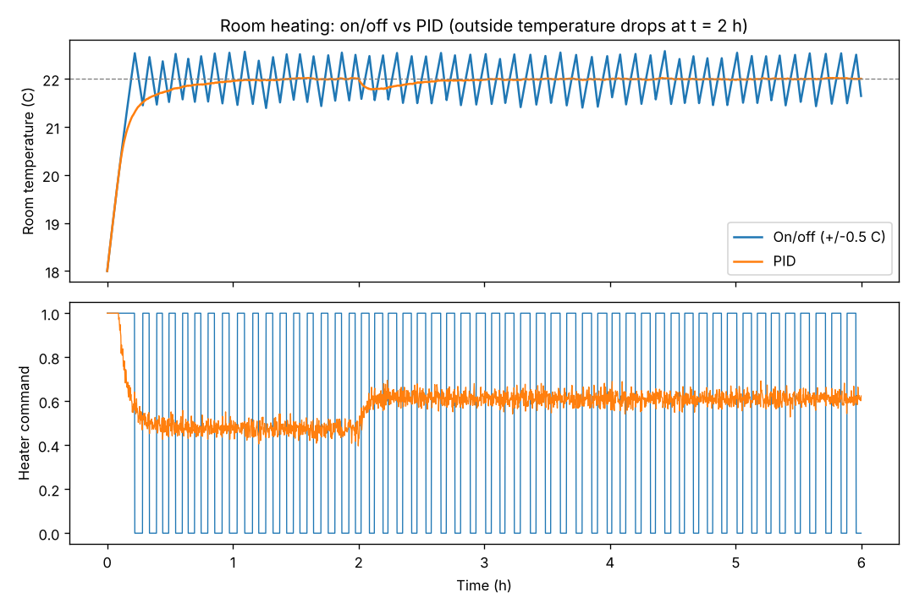

# Room Climate Control Simulation (Python)

A simulation of the kind of control logic used in building automation. It models a room's
temperature, controls it with a **PID controller** and a simple **on/off thermostat**, compares the two
with engineering metrics, and adds **alarm logic and a fail-safe** for sensor faults.

> A learning and portfolio project. The room is a simple first-order thermal model with made-up
> parameters; it is not calibrated to any real building or product, and it does not use a real
> building-automation protocol.

## What it demonstrates
- **Physical modelling:** first-order thermal model `dT/dt = (T_out - T)/tau + gain * u`
- **Control engineering:** PID with output limits, conditional-integration **anti-windup** and derivative-on-measurement; on/off control with hysteresis
- **Performance analysis:** rise time, overshoot, settling time, steady-state error, IAE, energy and actuator switch count
- **Alarm engineering:** high/low limits with on-delay timers and hysteresis, sensor-range validation
- **Fail-safe design:** an invalid sensor reading switches the heater off and raises `SENSOR_FAULT`, then control resumes when the sensor recovers
- **Software quality:** abstract `Controller` interface, seeded noise for reproducible runs, 24 pytest tests

## Result
Heating a room from 18 C to 22 C with sensor noise (std 0.05 C); the outside temperature drops from 5 C to 0 C at t = 2 h:

```
controller           rise (min)  overshoot %  settle (min)  SS err (C)       IAE   energy  switches
On/off (+/-0.5 C)          10.3         14.5         357.7      -0.008      6616    12520       101
PID                        20.0          0.5          16.7      -0.005      2600    12530         0
```
- PID settles in about 17 minutes with 0.5% overshoot, rejects the disturbance and never switches.
- On/off is faster at first but keeps oscillating around the setpoint and switched the heater 101 times in 6 hours, which causes equipment wear.
- Both use about the same energy.



## Run it
```bash
pip install pytest matplotlib
python run_comparison.py      # prints the table, writes output/comparison.csv and .png
pytest                        # 24 tests
```

## Project structure
```
hvac/model.py         room thermal model
hvac/controllers.py   Controller interface, OnOffController, PIDController
hvac/alarms.py        AlarmMonitor (limits, on-delay, hysteresis, sensor fault)
hvac/simulate.py      closed-loop simulation and metrics
run_comparison.py     comparison script and plot
tests/test_hvac.py    tests
```

## Ideas to extend
- Add cooling and a dead zone so heating and cooling never fight each other
- Tune PID gains automatically (for example Ziegler-Nichols) and compare
- Add a second zone with heat exchange between rooms
- Read a real temperature CSV instead of the simulated outside profile

## Author
**Saranpaulraj V** - [GitHub](https://github.com/SaranLm) · [LinkedIn](https://www.linkedin.com/in/saranpaulraj-v-7a6296258)
